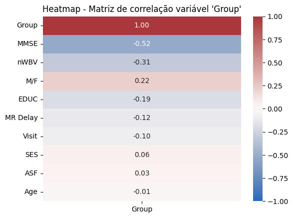
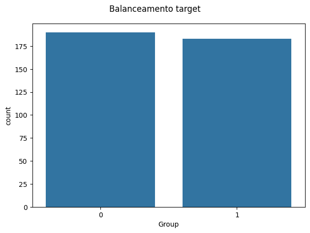
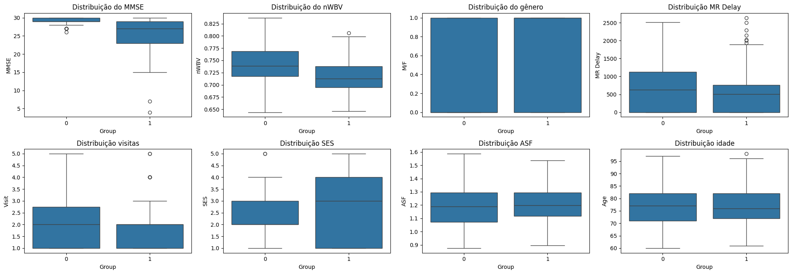
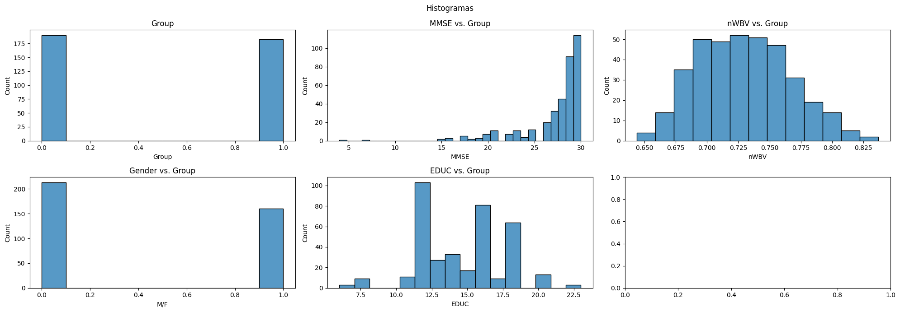
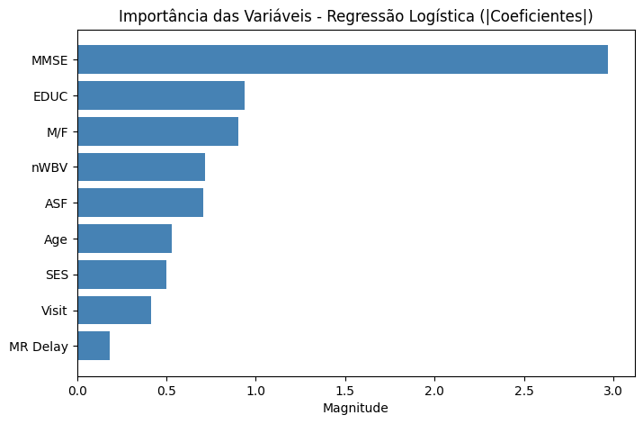
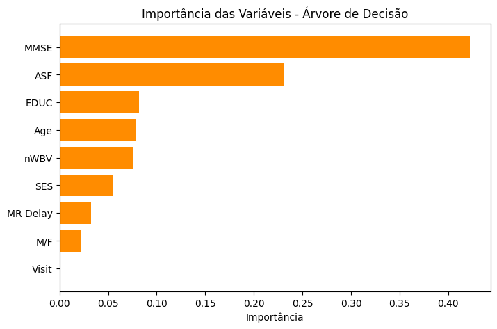
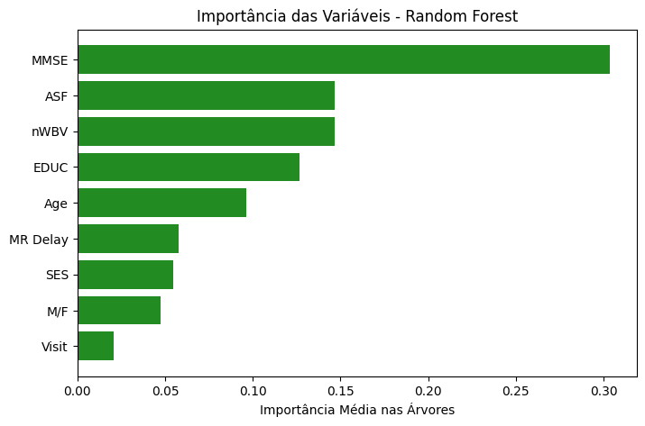

# Desafio 6 - Classificação

Sexto desafio prático desenvolvido pela **Squad Ada Lovelace** durante o **Bootcamp Data Analytics**, promovido pela **WoMakersCode**.

O objetivo deste desafio foi treinar e comparar modelos de classificação (Regressão Logística, Árvore de Decisão e Random Forest) para prever se um paciente apresenta ou não sinais de demência.

## Sobre o desafio

O desafio propôs a análise de uma base com informações clínicas e demográficas de pacientes com potencial risco de Alzheimer (base longitudinal **OASIS**), com o objetivo de prever se o paciente apresenta ou não sinais de demência.

A base contém **373 registros de exames, de 150 pacientes**, cada um acompanhado em uma ou mais visitas, e **15 colunas**: identificadores, grupo do paciente, número da visita, intervalo entre visitas, sexo, mão dominante, idade, anos de estudo, status socioeconômico (SES), MMSE (teste cognitivo), CDR (escala clínica de demência), volume intracraniano (eTIV), volume cerebral normalizado (nWBV) e fator de escala (ASF). Os únicos valores ausentes estavam em SES (19) e MMSE (2), e não havia linhas duplicadas.

É possível acessar o arquivo em Jupyter Notebook clicando [aqui](/Ada_Lovelace_Estatística_com_Python_Classificação___Bootcamp_Data_Analytics_2026_1.ipynb).

## O que foi feito

O notebook segue essa estrutura:

1. **Importação e exploração inicial** dos dados, com dicionário de dados completo.
2. **Tratamento dos dados**: remoção das colunas `Hand` (valor único), `MRI ID` (identificador do exame) e `CDR` (usada para o diagnóstico, o que causaria vazamento de informação), criação da variável alvo e codificação do sexo.
3. **Correlação e balanceamento**: matriz de correlação de Spearman, remoção do `eTIV` (correlação de -0,99 com o `ASF`) e verificação do balanceamento das classes.
4. **Divisão treino/teste por paciente**: 80% dos pacientes para treino e 20% para teste, garantindo que nenhum paciente apareça nos dois conjuntos.
5. **Pré-processamento**: imputação de valores ausentes pela mediana e padronização, ajustadas apenas com os dados de treino.
6. **Treino e avaliação** dos três modelos, com análise crítica dos resultados.
7. **Importância das variáveis** em cada modelo, e discussão de desempenho por grupo, detecção em estágio inicial e ajustes possíveis.

### Como a variável alvo foi construída

A coluna `Group` tinha três categorias, transformadas em uma variável binária:

| Categoria original | Significado | Valor |
|---|---|:---:|
| `Nondemented` | Sem demência em todas as visitas | 0 (sem demência) |
| `Demented` | Já tinha demência na primeira visita | 1 (com demência) |
| `Converted` | Sem demência na primeira visita, diagnosticado em visitas seguintes | 1 (com demência) |

Resultado: 190 registros sem demência (50,9%) e 183 com demência (49,1%), ou seja, classes bem equilibradas.

### Por que a divisão foi feita por paciente

Como o mesmo paciente aparece em várias visitas, uma divisão aleatória das linhas colocaria visitas do mesmo paciente no treino e no teste, e o modelo poderia "decorar" o paciente em vez de aprender o padrão da doença. Por isso foi usado o `GroupShuffleSplit`, que separa **pacientes** inteiros: 120 pacientes (297 registros) no treino e 30 pacientes (76 registros) no teste, sem nenhuma sobreposição. Com isso, as proporções ficaram em 51,9% de casos com demência no treino e 38,2% no teste.

## Perguntas respondidas

| # | Pergunta | Resumo do código | Resposta |
|---|----------|-------------------|----------|
| 1 | Análise exploratória e principais preditores de `Group` (tratando nulos, codificando categóricas e normalizando) | `df.info()`, `df.isna()`, `corr('spearman')`, `sns.heatmap()`, boxplots e histogramas, `SimpleImputer` e `StandardScaler` | `MMSE` (-0,58) e `nWBV` (-0,31) são os preditores mais correlacionados com o diagnóstico; sexo (0,22) e anos de estudo (-0,19) vêm em seguida |
| 2 | Treine um modelo de classificação | `LogisticRegression`, `DecisionTreeClassifier` e `RandomForestClassifier`, avaliados com matriz de confusão, acurácia, precisão, revocação e F1-score | Os três foram treinados e comparados (tabela abaixo) |
| 4 | Qual a importância relativa de cada variável no modelo final? | Coeficientes da regressão logística e `feature_importances_` das árvores | `MMSE` é a mais importante nos três modelos; volume cerebral (`ASF` e `nWBV`) vem em seguida |
| 5 | O modelo apresenta bom desempenho nos dois grupos? | Leitura da matriz de confusão por classe | Não. O modelo identifica razoavelmente quem tem demência, mas erra muito ao classificar pacientes saudáveis |
| 6 | É possível identificar pacientes em estágio inicial de demência? | Acertos do modelo apenas nos 12 registros `Converted` do teste | Com muita dificuldade: os modelos acertaram entre 3 e 6 dos 12 registros |
| 7 | O modelo apresenta overfitting ou underfitting? Como ajustar? | Comparação entre desempenho no treino e no teste | Desempenho baixo no teste e muito acima no treino, compatível com overfitting; ajustes sugeridos abaixo |

### Comparação dos modelos (conjunto de teste)

| Modelo | Acurácia | Precisão | Revocação | F1-Score | Falsos negativos | Falsos positivos |
|---|:---:|:---:|:---:|:---:|:---:|:---:|
| **Regressão Logística** | **65,8%** | **54,1%** | 69,0% | 60,6% | 9 | 17 |
| **Árvore de Decisão** | 64,5% | 52,3% | **79,3%** | **63,0%** | **6** | 21 |
| **Random Forest** | 59,2% | 47,6% | 69,0% | 56,3% | 9 | 22 |

Em diagnósticos médicos, a **revocação** costuma ser a métrica mais crítica, já que deixar passar um paciente com demência (falso negativo) é mais grave do que pedir exames adicionais para um falso alarme. Por esse critério, a Árvore de Decisão foi a que mais encontrou casos de demência, mas ao custo de mais falsos alarmes em pessoas saudáveis. A Regressão Logística teve a maior acurácia e a maior precisão, sendo a opção mais equilibrada. O Random Forest, sem ajuste de hiperparâmetros, teve o pior desempenho.

### Importância das variáveis

| Variável | Regressão Logística (coeficiente) | Árvore de Decisão | Random Forest |
|---|:---:|:---:|:---:|
| `MMSE` | -2,97 | 42% | 30% |
| `ASF` | 0,70 | 23% | 15% |
| `nWBV` | -0,72 | 8% | 15% |
| `EDUC` (anos de estudo) | -0,94 | 8% | 13% |
| `M/F` (sexo) | 0,90 | 2% | 5% |
| `Age` | -0,53 | 8% | 10% |
| `SES` | -0,50 | 6% | 6% |
| `Visit` e `MR Delay` | -0,42 e 0,18 | 0% e 3% | 2% e 6% |

- **`MMSE`** é, com folga, a variável mais importante: na regressão logística, quanto menor a pontuação, maior a chance do diagnóstico de demência.
- **Volume cerebral** (`ASF` e `nWBV`) é o segundo grupo mais relevante.
- **Variáveis demográficas** têm peso intermediário; na regressão logística, mais anos de estudo estão associados a menor chance de demência.
- **Tempo e visitas** (`Visit` e `MR Delay`) têm a menor importância relativa, abaixo de 6% nas árvores.

> Os coeficientes da regressão logística estão em escala padronizada, e as importâncias das árvores somam 100%. Por serem medidas diferentes, os valores não são comparáveis diretamente entre colunas; compare a **ordem** das variáveis em cada modelo.

### Desempenho por grupo

Não totalmente: há uma assimetria importante.

- **Sem demência (0):** a precisão é alta (74% a 81%), mas a revocação é baixa (53% a 64%). Quando o modelo diz que o paciente é saudável, costuma acertar, mas classifica como doentes muitos pacientes saudáveis (falsos positivos).
- **Com demência (1):** a revocação é boa (69% a 79%), mas a precisão é baixa (48% a 54%). O modelo captura a maioria dos pacientes com demência, mas gera um volume alto de falsos alarmes.

### Detecção em estágio inicial

Foram analisados os **12 registros do grupo `Converted`** no conjunto de teste (pacientes que entraram no estudo cognitivamente normais e desenvolveram demência depois):

| Modelo | Acertos | Taxa |
|---|:---:|:---:|
| Regressão Logística | 3 de 12 | 25,0% |
| Árvore de Decisão | 6 de 12 | 50,0% |
| Random Forest | 3 de 12 | 25,0% |

Isso acontece porque pacientes em fase de transição ainda têm `MMSE` e volume cerebral (`nWBV`) muito próximos de pessoas saudáveis. Como a variável `CDR` foi removida (ela indicaria o estágio diretamente) e não foram criadas variáveis de evolução ao longo do tempo (por exemplo, a variação do `MMSE` entre a primeira e a segunda visita), o modelo estático não consegue detectar o estágio inicial.

### Overfitting ou underfitting?

A acurácia nos dados de **treino** foi de 83,8% na Regressão Logística e de 100% na Árvore de Decisão e no Random Forest, contra 59% a 66% no teste. Essa diferença grande indica **overfitting**: os modelos, principalmente as árvores, aprendem os dados de treino de memória e não generalizam bem para pacientes novos. O tamanho reduzido da base (apenas 150 pacientes) agrava o problema.

Formas de ajustar:

- **Ajuste de hiperparâmetros** (por exemplo, limitar a profundidade das árvores), testando valores progressivamente.
- **Modelos mais robustos** para uma melhor leitura do dataset.
- **Criação de variáveis (feature engineering)**, combinando variáveis do dataset, como a variação do `MMSE` e do volume cerebral entre visitas.
- **Estudo mais aprofundado das variáveis no contexto médico**, para entender como cada uma se comporta em casos reais.

O balanceamento de classes poderia ser uma alternativa, mas o dataset já está bem balanceado.

## Visualizações

### Correlação das variáveis com o diagnóstico

O heatmap ordena as variáveis pela força da correlação com o diagnóstico. `MMSE` (-0,58) se destaca: pacientes com pontuação menor no teste cognitivo têm mais chance de estar no grupo com demência. `nWBV` (-0,31) vem em seguida, coerente com a ideia de que a perda de volume cerebral é um indicador de atrofia.

### Balanceamento da variável alvo

As classes estão praticamente equilibradas (50,9% sem demência e 49,1% com demência), o que dispensou técnicas de balanceamento.

### Distribuição das variáveis por grupo

Os boxplots comparam cada variável entre pacientes sem e com demência. As diferenças mais claras aparecem em `MMSE` e `nWBV`, o que confirma o que a matriz de correlação já indicava.

### Importância das variáveis em cada modelo

Nos três modelos, `MMSE` aparece no topo. A ordem das demais variáveis muda de um modelo para outro, o que é esperado, já que a regressão logística mede o efeito linear de cada variável e as árvores medem quanto cada uma ajuda a separar os grupos.

## Conclusões

- Sem a variável `CDR`, a análise ficou mais difícil e o modelo passou a ter um desempenho desequilibrado.
- A Regressão Logística foi a opção mais equilibrada, enquanto a Árvore de Decisão identificou mais casos de demência, mas gerou muitos alarmes falsos em pessoas saudáveis.
- O modelo teve grande dificuldade para identificar a doença no início, porque pacientes no começo do quadro ainda têm exames parecidos com os de pessoas saudáveis e o modelo não acompanhou a evolução do paciente ao longo do tempo.

## Tecnologias utilizadas

- Python
- Pandas
- Numpy
- Matplotlib
- Seaborn
- Scikit-learn
- Statsmodels
- Jupyter Notebook

## Como executar

1. Clone este repositório.
2. Abra o notebook `Ada_Lovelace_Estatística_com_Python_Classificação___Bootcamp_Data_Analytics_2026_1.ipynb` no Jupyter ou no Google Colab.
3. Execute as células em ordem — a base de dados é carregada diretamente de uma URL, sem necessidade de download manual.

---

  Feito com 💜 por nosso Squad!

